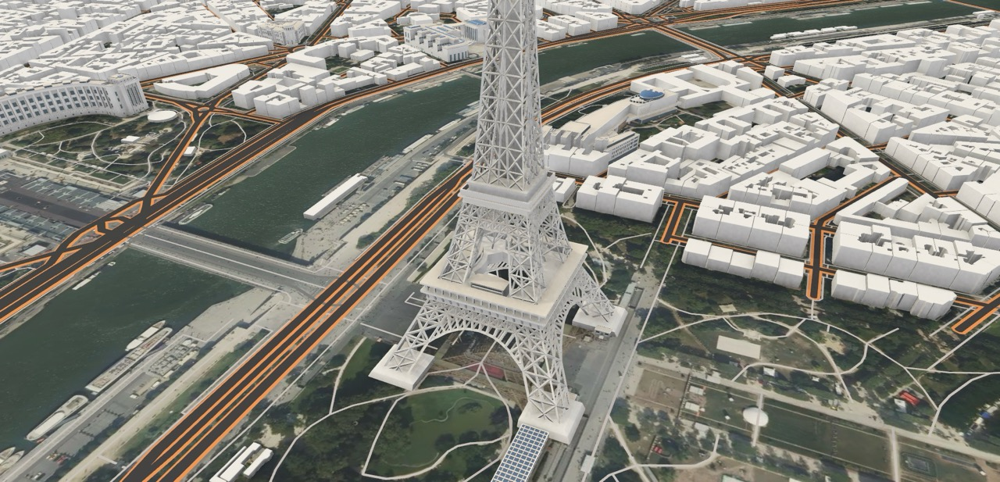

## Landmarks Module

The Landmarks Module adds detailed 3D landmark buildings to your map. These are high-quality, architect-modeled buildings with PBR materials — significantly more detailed than the basic extruded buildings produced by the Vector or Components modules.

When landmarks are enabled, the SDK automatically hides any basic OSM buildings that overlap with a landmark, so you don't get double geometry.

This module ships as **preview** in v3.2.0. The two limitations most likely to be hit are that dynamic map scaling is not supported (landmark heights go wrong after a zoom step if the map uses `DynamicScalingMapInformation`), and that selection only ever picks a whole landmark, never one part of it — a raycast hit cannot be resolved down to a feature id even though the per-vertex data for that exists. See [Known Gaps](LandmarksModuleKnownGaps.md) for these and everything else outstanding.

---

### Quick Start

The easiest way to get started is to import the demo scene. Open the **Package Manager** window (`Window → Package Manager`), find the **Mapbox Unity SDK** package, and go to the **Samples** tab. Click **Import** next to the Landmark Demo — this gives you a fully configured scene you can open and play immediately.

To add landmarks to your own scene, follow the steps below.

---

### Setting Up Landmarks

**Prerequisites:** A working map with `MapboxMapBehaviour` and at least one building module (Components Module or Vector Module). Zoom level must be 14 or higher.

Landmarks are delivered as compressed glTF, so the SDK depends on **glTFast** (`com.unity.cloud.gltfast`) and **meshoptimizer decompression** (`com.unity.meshopt.decompress`). The Package Manager installs both automatically — no action needed. Neither is removable: the tiles are meshopt-compressed and say so in `extensionsRequired`, so glTFast refuses to load them without the decoder, and `MapboxLandmarksModule` requires both packages to compile at all. If you are on Unity 6 you may raise the glTFast version in your own project manifest; the module is built against APIs that are unchanged in later releases.

#### Step 1: Add the Landmarks Module

1. Select your map GameObject (the one with `MapboxMapBehaviour`)
2. Add the `LandmarksLayerModuleScript` component
3. Assign a **Base Material** — this is the PBR material used for all landmark models. The default is `LandmarkMaterialGLTF.mat` included in the package under `LandmarksModule/Materials/`

That's it — landmarks will now appear on the map. But you'll likely see basic OSM buildings overlapping with the landmarks. The next steps fix that.

#### Step 2: Suppress Overlapping Buildings

You need one connector for each building module you're using. Most projects use either the Components Module or the Vector Module for buildings, not both — so you typically only need one connector.

**If you're using the Components Module for buildings:**

1. Add `LandmarkToBuildingComponentConnector` to your map GameObject
2. Assign:
   - **Map** → your `MapBehaviourCore`
   - **LandmarksLayerModuleScript** → the landmarks module you added in Step 1
   - **BuildingLayerVisualizerObject** → the `BuildingComponentVisualizerObject` asset your Components Module uses

**If you're using the Vector Module for buildings:**

1. Create a filter asset: right-click in Project → `Create → Mapbox → Filters → Landmark Polygon Filter`
2. Open your vector building layer's filter stack asset and add the new filter to its **Filters** list
3. Add `LandmarkToVectorConnector` to your map GameObject
4. Assign:
   - **Map** → your `MapBehaviourCore`
   - **LandmarksLayerModuleScript** → the landmarks module you added in Step 1
   - **VectorModuleScript** → your vector module
   - **LandmarkFilter** → the filter asset you created in step 1

#### Step 3: Play

Enter Play Mode. Landmark buildings appear as detailed 3D models. Basic OSM buildings at the same locations are automatically suppressed.

---

### How the Overlap Suppression Works

The two connectors use different strategies based on how each building module works:

- **Components connector** — The Components Module bakes all buildings into a single merged mesh per tile, so individual buildings can't be skipped during generation. Instead, the connector detects overlapping buildings after they're generated and hides them by zeroing their vertices.

- **Vector connector** — The Vector Module processes buildings one at a time through a filter stack before generating meshes. The connector injects landmark footprint polygons into this filter stack, so overlapping buildings are simply never created. This is more efficient since no geometry is wasted.

Both connectors handle the case where landmarks and buildings load in either order. If buildings load first, they're checked (or reprocessed) when landmarks arrive. If landmarks load first, the data is ready when buildings are processed.

---

### Sitting on Terrain

If a terrain module is present in the scene, landmark buildings automatically sit on the elevated terrain surface instead of floating at the flat map plane — no setup is required beyond having both modules in the scene.

A building snaps to the **lowest** point under its own footprint rather than the elevation at its centre. A flat-bottomed building placed at its centre height would leave the downhill edge floating in the air on any slope; snapping to the lowest point buries the uphill edge instead, which is what a real foundation does and is what reads as correct.

Terrain data usually arrives after the landmark's own tile, not before it. A building whose terrain has not arrived yet is left at ground level rather than guessing, and is corrected to its proper height the moment that terrain's elevation data decodes — which can be slightly after the terrain tile visually "finishes loading" when the terrain shader path is in use, since the CPU-side elevation array decodes separately from the texture. You may see a building sit briefly at the flat map plane and then jump to its proper height; that is expected and self-corrects without any action.

With no terrain module in the scene, none of this runs and nothing is paid for: the snapping logic keys off a terrain data reference on the tile, and a tile with no terrain module simply never carries one.

---

### Selecting a Landmark

`LandmarkHighlightBehaviour` is a `Map`-GameObject component that raycasts on click, tints whichever landmark was hit, and tints the previous selection back to its default colour. It ships already added to the `Map` GameObject in the `LandmarkDemo` scene, with its shipped defaults (white default colour, red highlight, colliders on, convex hulls on) — open that scene and click a building to see it working.

It needs a camera tagged `MainCamera` in the scene; without one it logs a warning and disables itself rather than raycasting from nothing.

**`AddCollidersForSelection` is what makes clicks possible at all.** A landmark arrives from glTF with no collider, so with this off nothing can be hit and the component only ever clears the current selection. It is also the single most expensive step in bringing a landmark on screen, paid once per landmark whether or not anyone ever clicks it, because it is a `MeshCollider` cook. `UseConvexColliders` (on by default) cooks that collider as a convex hull instead of the exact building mesh, which is far cheaper and is enough for a click to identify which building was hit. Turn it off only if clicks have to follow the real silhouette — a building with a concave outline, such as a courtyard or an archway, will register hits in those gaps while the collider is a convex hull.

A hit's `LandmarkComponent.LandmarkId` is the tile's own id for the landmark, and is how you find out which one was clicked — read it off `hit.transform.gameObject.GetComponent<LandmarkComponent>()`, or off the GameObject a `VisualSelected` handler receives. The per-field tooltips on the component cover the rest.

---

### Troubleshooting

**Landmarks don't appear:**
- Confirm `LandmarksLayerModuleScript` is on the same GameObject as `MapboxMapBehaviour`
- Check that **Base Material** is assigned
- Make sure the map zoom level is 14 or higher
- Check the Console for errors

**Basic buildings still showing under landmarks:**
- Make sure you added the correct connector for your building module
- For the Vector connector: confirm the `LandmarkPolygonFilterObject` asset is in the vector building layer's filter stack
- For the Components connector: confirm the `BuildingComponentVisualizerObject` is assigned

**The sample's buttons do nothing, or clicking a landmark does nothing:**

The buttons depend on the legacy UI input path; landmark clicks do not. The sample scenes carry a `StandaloneInputModule` on their EventSystem, and under **Player Settings → Active Input Handling → Input System Package (New)** that module is inert, so the UI stops responding. Set Active Input Handling to **Both** to run the samples as shipped, or replace the EventSystem's input module with `InputSystemUIInputModule`. `LandmarkHighlightBehaviour` itself reads the mouse through whichever input handler is active and works under any setting, so if clicking a landmark still does nothing, check that **Add Colliders For Selection** is on and that the main camera is tagged `MainCamera`. The UI input module issue applies to every sample in the SDK, not just the landmark ones - see [`CameraSystem.md`](CameraSystem.md) for the same trade-off on the camera.

---

### The Landmark Tour Sample

`LandmarkTour` is a third sample that shows the landmark set rather than a single landmark. It opens looking straight down on continental Europe and flies the camera to a chosen landmark when you press one of the buttons on the left. Satellite imagery supplies the ground, vector buildings and landmarks fill in close up, and there is no terrain module.

Five things in that scene are worth understanding before you copy the pattern.

**Module order decides whether a tile can show its texture.** `MapboxMapVisualizer.CreateTile` asks each layer module in turn whether it is ready and **breaks on the first one that says no**, so a module earlier in the list can stop a later one from running at all. `StaticApiLayerModule.LoadInstant` is the only code that binds a tile's own imagery, so if it sits behind a module that is still fetching, the tile shows a placeholder for as long as that module is busy. Modules are collected with `GetComponents`, which returns inspector order — so in this scene the imagery module is deliberately placed **above** the vector and landmark modules. This ordering is invisible in the Inspector and easy to lose by adding a component; if a scene ever goes uniformly flat-coloured while loading, check it first.

**The Components module's zoom range is widened here, and that's now just an Inspector edit.** `RejectTilesOutsideZoom` is `(2, 16)` in this scene, wider than the shipped default of `(12, 16)`. `MapboxComponentsModuleScript` exposes `RejectTilesOutsideZoom`, `ClampDataLevelToMax` and `CacheSize` as serialized Inspector fields, so drawing vector content at continental zooms is a field edit on the component rather than a subclass — this scene used to carry a `LandmarkTourComponentsModuleScript` subclass whose entire body existed to change these three numbers, and that subclass is gone now that the base script can express the same thing directly. `LoadInstant`, inherited from the shared `VectorLayerModule` base that `MapboxComponentsModule` (the class `MapboxComponentsModuleScript` builds) extends, short-circuits to "ready" for tiles outside the configured range, so below zoom 2 here the module is transparent and never holds a tile up. Widening the range this far turns the module into a gate across every zoom from 2 to 16, and Mapbox Streets has little to offer below zoom 12 beyond water and landuse — widen it only if you actually need what it draws there.

**Flights are one continuous eased sweep, not a series of steps.** `MapFlightController` used to climb and descend in discrete steps, pausing after each to wait for that level's tiles. It doesn't anymore: `BuildZoomStep` now returns one uninterrupted eased sweep across the whole climb or descent, because animating each step separately with `SmoothStep` drove zoom velocity to zero at every step boundary, and a four-step climb read as four accelerate-decelerate cycles — exactly the stepping motion the steps were meant to hide. The tile problem that stepping used to solve is still real — the tile cover changes at every integer zoom crossing, and the fetch pipeline holds a queued request for 0.2 s before it may start and then starts only one per frame, so a fast sweep can have a level's requests aborted right as they become eligible — but it's now handled without stopping the camera: the sweep fires a background, fire-and-forget cover refresh every `ZoomLevelsPerStep` levels as it passes them, and the camera never waits on it. Detail can lag the camera by up to a step's worth of levels while the refresh catches up, which is the trade being made: a lagging texture reads far better than a stalling camera. `TileWaitTimeout: 0` now disables tile refreshing entirely rather than restoring any older racing behaviour — useful only if you want to see the sweep with no tile nudging at all.

**The three flight phases overlap so the camera never stops.** `CrossfadeSeconds` sets how many seconds the climb, cruise, and descent phases run into their neighbour before the previous one finishes, via `CrossfadeChain`; the camera reaches the end of one phase already moving into the next instead of stopping and restarting. This only ever crossfades zoom with pan — pitch is deliberately never part of it, and is always tilted at a fixed zoom before the sweep starts and after it ends. A camera looking straight down makes every tile's corners project to roughly zero distance along the (nonexistent) forward direction, which a tile's split test treats as "behind the camera" and force-splits regardless of actual distance; as pitch tilts away from straight down that flips back to ordinary distance-based splitting. Changing zoom at the same time — which changes tile size, and so the split threshold itself — can make that split decision flicker between frames, and a tile that drops out of the retained set for even one frame has its in-flight fetch cancelled with nothing to retry it. That is why pitch and zoom never move in the same frame here.

**The camera is never moved directly.** Every frame the flight pushes an interpolated view into `MapboxMap.ChangeView`, and `Moving3dCamera` follows because it subscribes to the map information's view events when it initializes. The flight disables `Moving3dCameraBehaviour` for its duration to keep user input out of the way, and writes the arrival zoom back into `Core.ZoomValue` afterwards so the first scroll does not jump. `MapCameraClipPlaneDriver` scales the near and far planes with the camera's distance from the map, which a scene spanning zoom 4 to 17 needs — and it runs off `ViewChanged` rather than `Update`, because the tile provider culls against the far plane and `ViewChanged` fires before the map redraws.

Landmarks only load at zoom 14 and above, so every destination uses 17 or higher.

---

### Further Reading

For technical details on the collision detection algorithms, coordinate space transforms, tile edge handling, terrain snapping, event lifecycle, and architecture, see [Landmarks Module Internals](LandmarksModuleInternals.md).

For what the module does not do yet — including the fact that **dynamic map scaling is unsupported**, and that selection cannot be resolved below whole-landmark granularity — see [Known Gaps](LandmarksModuleKnownGaps.md).
